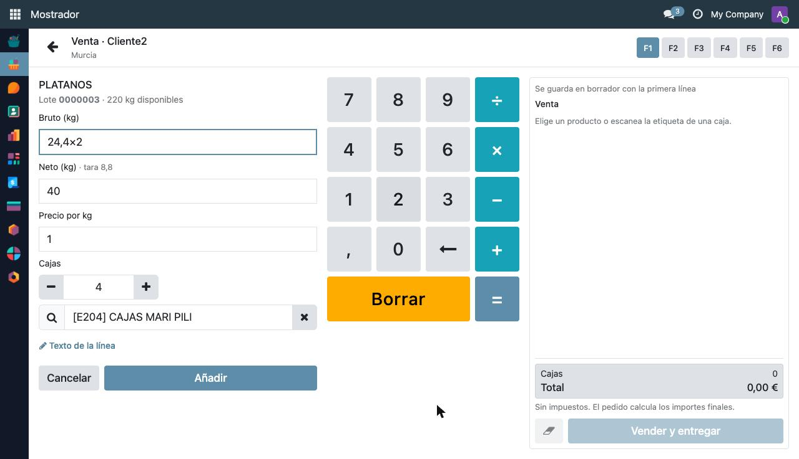

# 02 · El Mostrador

El **Mostrador** es la aplicación táctil del puesto. Se abre desde la pantalla de inicio de Odoo (icono *Mostrador*) o con la dirección `/odoo/mercas-touch`.

## Pantalla de inicio

Hay un botón por tarea, cada uno con su tecla de función:

| Tecla | Modo | Lo usa |
|---|---|---|
| **F1** | Venta | Báscula (y el encargado para facturar) |
| **F2** | Compra | Encargado |
| **F3** | Cajas | Báscula |
| **F4** | Lotes | Encargado |
| **F5** | Cobros | Báscula y encargado |
| **F6** | Etiqueta dañada | Báscula |

- Dentro de cada modo, los botones **F1–F6** de la esquina superior derecha cambian de modo, y la **flecha ←** (o la tecla **Esc**) vuelve atrás.
- **F5 no recarga la página** en el Mostrador: abre *Cobros*. Para recargar, usa el botón del navegador.
- El botón de descarga (arriba a la derecha) **instala el Mostrador como aplicación** en la tablet.

## Teclado numérico y calculadora

Todos los números (kg, precio, importe…) se pueden escribir con el **teclado de la pantalla**, con el del dispositivo o con una **báscula que escriba como teclado**.

- La columna de la derecha (÷ × − +) es una **calculadora**. En la captura, el bruto se ha escrito como `24,4×2`: dos pesadas de 24,4 kg. Al pulsar **=**, o al pasar a otro campo, se convierte en 48,8.
- **Borrar** vacía el campo y **←** borra la última cifra.
- En los campos de cajas la calculadora no está disponible: solo admiten números enteros.

## Todo se guarda solo

No hay botón de «Guardar». Arriba del ticket aparece **✔ Guardado en S00001** (o en P00001, en una compra) en cuanto se añade la primera línea. Si te llaman a mitad de una venta, puedes salir con la flecha y retomarla después desde la lista **En curso**.

## Las listas: En curso, Para facturar y Todos

Al entrar en Venta (F1) o Compra (F2) se ve la lista de documentos con tres filtros:

- **En curso:** borradores que se están preparando.
- **Para facturar:** pedidos ya entregados o recibidos que aún no tienen factura.
- **Todos:** cualquier pedido, salvo los cancelados.

El buscador filtra por número o por nombre del cliente o del proveedor.
