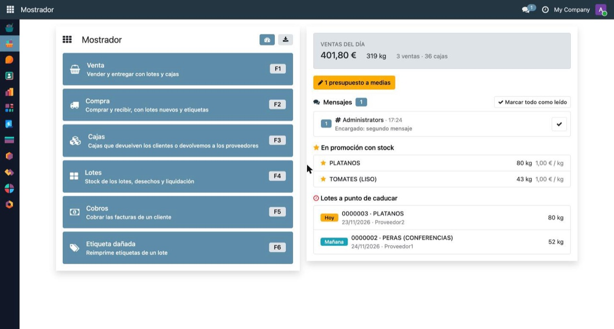
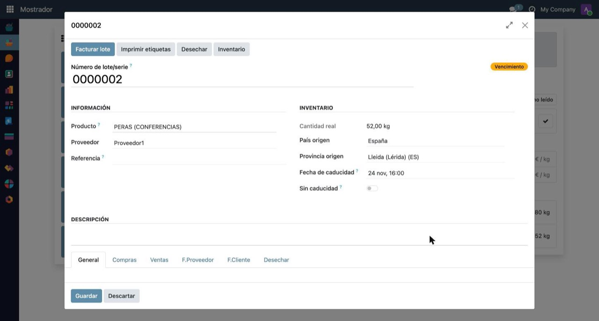

# 02 · El Mostrador

El **Mostrador** es la aplicación táctil del puesto. Se abre desde la pantalla de inicio de Odoo (icono *Mostrador*) o con la dirección `/odoo/mercas-touch`.

## Pantalla de inicio

Hay un botón por tarea, cada uno con su tecla de función:

| Tecla | Modo | Lo usa |
|---|---|---|
| **F1** | Venta | Báscula (y el encargado para facturar) |
| **F2** | Compra | Encargado |
| **F3** | Cajas | Báscula |
| **F4** | Lotes | Encargado |
| **F5** | Cobros | Báscula y encargado |
| **F6** | Etiqueta dañada | Báscula |

- Dentro de cada modo, los botones **F1–F6** de la esquina superior derecha cambian de modo, y la **flecha ←** (o la tecla **Esc**) vuelve atrás.
- **F5 no recarga la página** en el Mostrador: abre *Cobros*. Para recargar, usa el botón del navegador.
- El botón de descarga (arriba a la derecha) **instala el Mostrador como aplicación** en la tablet.

## El cuadro de mandos (a la derecha)

Junto a los botones está lo que hay que saber de un vistazo. En una pantalla estrecha sale debajo de los botones.

| Apartado | Qué muestra | Qué hacer |
|---|---|---|
| **Ventas del día** | Importe sin impuestos, kg netos, número de ventas y de cajas. | Solo informa. |
| **Presupuestos a medias** y **ventas por entregar** | Ventas que alguien dejó sin terminar, y ventas confirmadas que aún no han salido. | Toca el botón amarillo para ir a **F1 › En curso**. |
| **Mensajes** | Canales y chats con mensajes sin leer: cuántos, de quién y el último. | Toca la fila para abrir la conversación y contestar. Con **✓** se marca como leída sin abrirla; **Marcar todo como leído** las marca todas. |
| **En promoción con stock** ⭐ | Productos marcados con la estrella que tienen stock, con los kg y el precio. | Son los que hay que ofrecer primero. |
| **Lotes a punto de caducar** | Lotes con stock que caducan pronto, los caducados primero: «Caducado», «Hoy», «Mañana» o «En N días». | Toca el lote para abrir su ficha. Véndelo antes, o desecha lo que ya no sirva (F4). |
| **Lotes sin fecha de caducidad** | Lotes con stock sin fecha y sin marcar como «Sin caducidad». | Toca el lote y rellena su **Fecha de caducidad** o marca **Sin caducidad**. |

- Al tocar un lote se abre **su ficha**, igual que con *Detalle* en F4. Se puede corregir la fecha de caducidad, marcar *Sin caducidad*, o desechar, imprimir etiquetas o hacer inventario. Al cerrarla, el cuadro se actualiza.
- El cuadro **se actualiza solo** con cada venta, compra o desecho, en cualquier pantalla, al llegar un mensaje y, además, cada 5 minutos.
- El botón del **cuentakilómetros** (arriba, junto al de descarga) **muestra u oculta** el cuadro. En morado se ve; en gris está oculto. Cada tablet recuerda su elección: se puede ocultar en una báscula y dejar en otra.
- Qué productos salen en promoción y con cuántos días de antelación avisa cada lote lo decide el encargado ([capítulo 13](13_encargado_cuadro_de_mandos.md)).

## Teclado numérico y calculadora

Todos los números (kg, precio, importe…) se pueden escribir con el **teclado de la pantalla**, con el del dispositivo o con una **báscula que escriba como teclado**.

- La columna de la derecha (÷ × − +) es una **calculadora**. En la captura, el bruto se ha escrito como `24,4×2`: dos pesadas de 24,4 kg. Al pulsar **=**, o al pasar a otro campo, se convierte en 48,8.
- **Borrar** vacía el campo y **←** borra la última cifra.
- En los campos de cajas la calculadora no está disponible: solo admiten números enteros.

## Todo se guarda solo

No hay botón de «Guardar». Arriba del ticket aparece **✔ Guardado en S00001** (o en P00001, en una compra) en cuanto se añade la primera línea. Si te llaman a mitad de una venta, puedes salir con la flecha y retomarla después desde la lista **En curso**.

## Las listas: En curso, Para facturar y Todos

Al entrar en Venta (F1) o Compra (F2) se ve la lista de documentos con tres filtros:

- **En curso:** borradores que se están preparando.
- **Para facturar:** pedidos ya entregados o recibidos que aún no tienen factura.
- **Todos:** cualquier pedido, salvo los cancelados.

El buscador filtra por número o por nombre del cliente o del proveedor.
