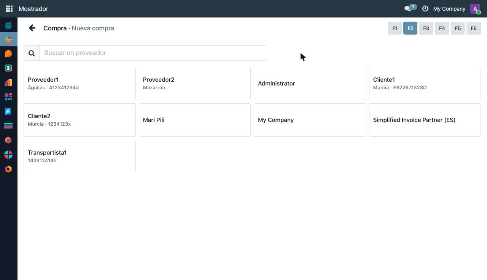
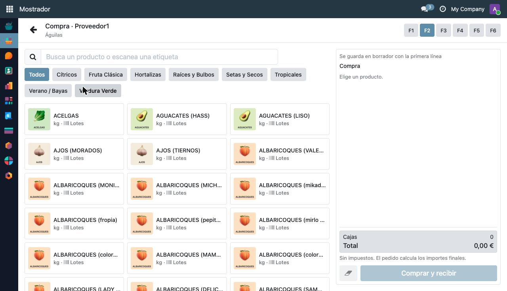
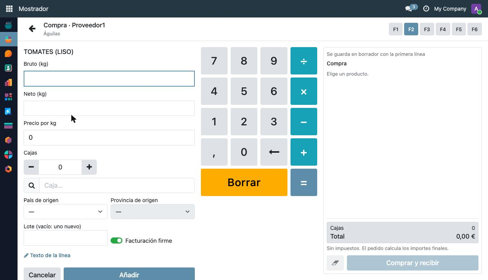
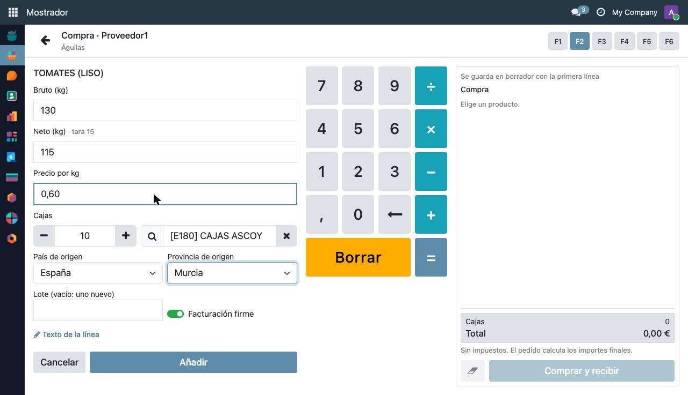
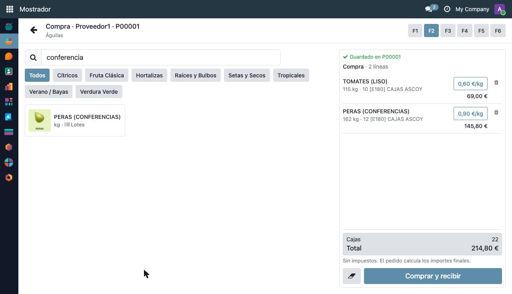
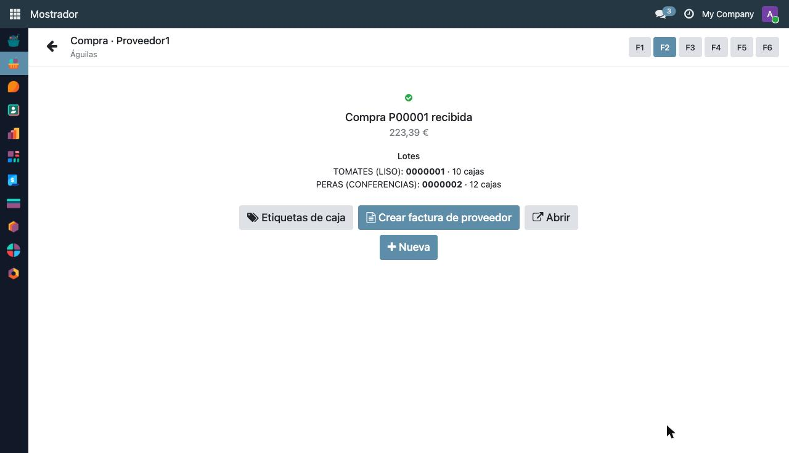
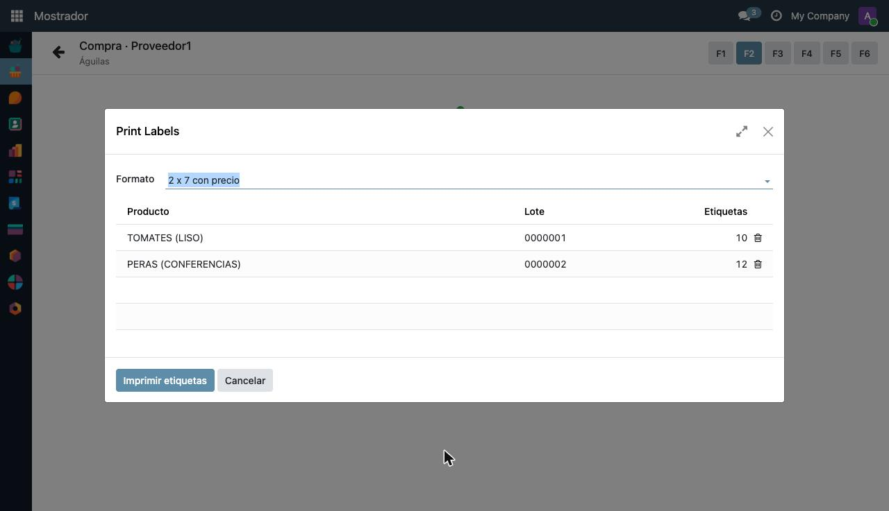
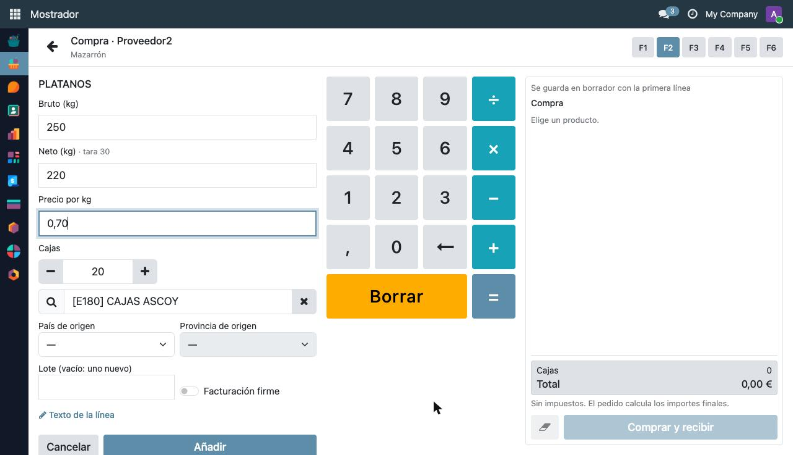
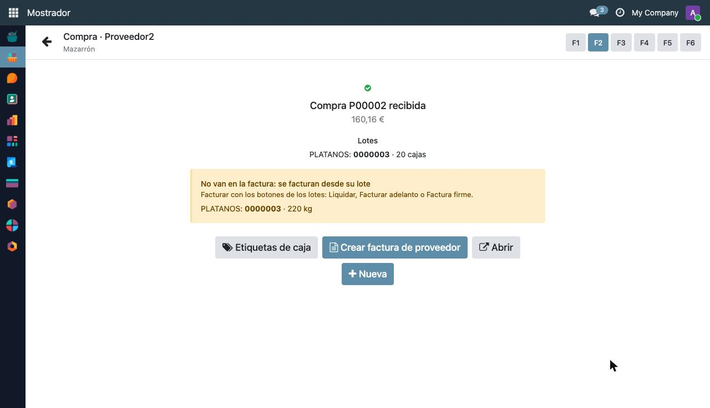

# 10 · Comprar y recibir (F2) · Encargado

**Objetivo:** dar de alta la mercancía que llega por la mañana, con su lote, sus cajas y su origen, e imprimir las etiquetas.

**Ejemplo:** Proveedor1 nos trae tomate y pera en cajas ASCOY.

## 1. Nueva compra y proveedor

Pulsa **F2**, luego **+ Nueva compra**, y busca el proveedor por nombre, NIF o teléfono.

## 2. Producto

Los productos salen en tarjetas por categoría. Puedes tocar una categoría o escribir en el buscador.

> Solo aparecen los productos de las categorías marcadas como **Mercancía de mercado**. Si falta una fruta, revisa su categoría.

## 3. La línea: bruto, cajas, precio, origen y lote

Rellénala en este orden:

1. **Bruto (kg):** lo que marca la báscula, con las cajas.
2. **Cajas:** el número y el **tipo de caja** (búscalo por nombre en «Caja…»). En cuanto hay cajas aparece la tara y se calcula el **Neto**.
3. **Precio por kg.**
4. **País y provincia de origen.**
5. **Lote:** déjalo **vacío** para que se cree uno nuevo. Escribe un número solo si el proveedor trae su propio lote.
6. **Facturación firme:** ya viene marcada o no según el proveedor. Cámbiala solo si para esta partida el trato es distinto.

En el ejemplo: 130 kg brutos, 10 cajas ASCOY de 1,5 kg (tara 15), **neto 115 kg** a 0,60 €/kg, origen Murcia y facturación firme.

Pulsa **Añadir**. La línea pasa al ticket de la derecha y la compra queda guardada como borrador (P00001).

## 4. Ticket y «Comprar y recibir»

- Repite el paso 3 con cada producto.
- Tocando el **precio** de una línea se corrige. La papelera borra la línea.
- Cuando todo esté, pulsa **Comprar y recibir**: se confirma el pedido, entra el stock y se crean los lotes.

## 5. Etiquetas de caja

**Etiquetas de caja** propone una etiqueta por cada caja comprada. Puedes cambiar el formato y el número de etiquetas antes de imprimir.

> Pega una etiqueta en cada caja. En la venta, escanearla abre directamente el lote.

## 6. Proveedor en liquidación por venta

Con **Proveedor2** la casilla **Facturación firme** viene desmarcada: se le pagará según lo que se venda (ver [capítulo 11](11_encargado_lotes.md)).

Al recibir, el Mostrador avisa de que esas líneas **no van en la factura de la compra**, porque se facturan desde el lote:

## 7. Factura del proveedor en firme

Para un proveedor en firme, **Crear factura de proveedor** (en la pantalla final o en el resumen de la compra, filtro *Para facturar*) crea la factura en borrador con los lotes firmes y las cajas, para revisarla y confirmarla.

## Comprobación rápida

- [ ] ¿El neto cuadra con lo que dice el albarán del proveedor?
- [ ] ¿El origen está puesto? Sale en la etiqueta y en la DeCA.
- [ ] ¿Firme o liquidación es lo pactado con este proveedor?
- [ ] ¿Etiquetas impresas y pegadas?
