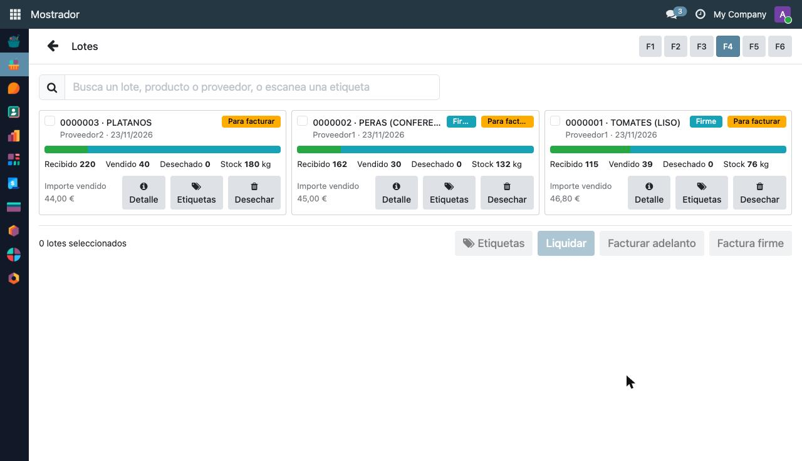
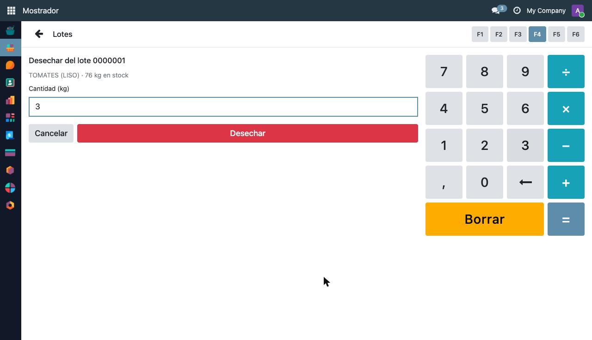
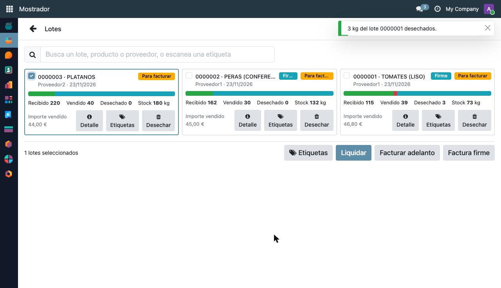
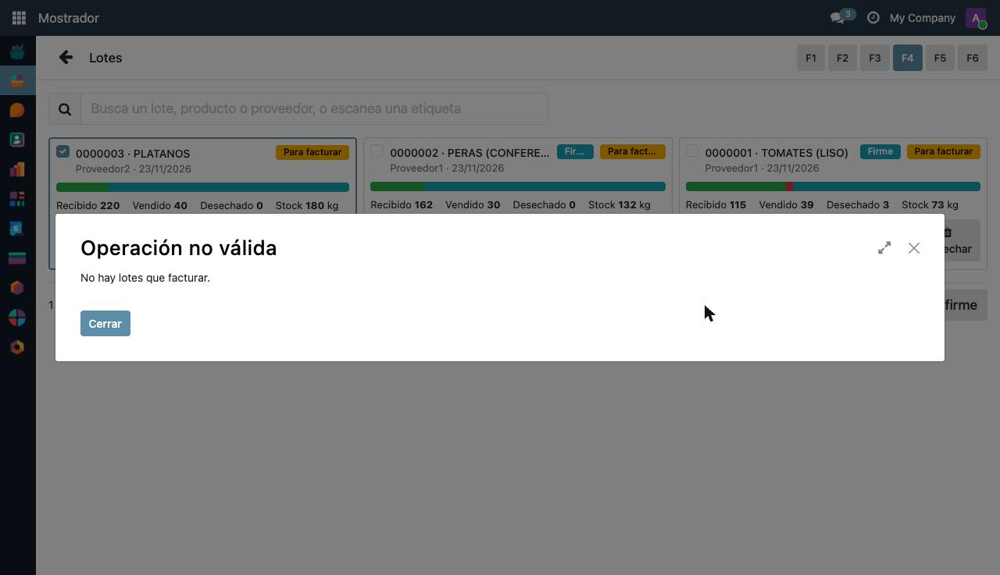
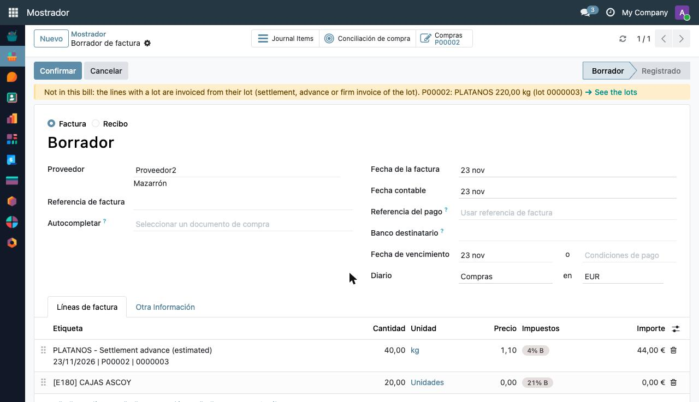

# 11 · Lotes: stock, desechos y liquidación (F4) · Encargado

**Objetivo:** ver cómo va cada lote, registrar la mercancía que se tira y pagar al proveedor lo que toca.

## La pantalla de lotes

Cada tarjeta es un lote pendiente de facturar al proveedor, con el último recibido primero:

- La **barra** muestra lo vendido (verde), lo desechado (rojo) y lo que queda en almacén (azul).
- Debajo, en kg: **Recibido · Vendido · Desechado · Stock**, y el importe vendido.
- Etiquetas: **Firme** (facturación firme) y **Para facturar**.
- El buscador acepta lote, producto o proveedor. También se puede **escanear la etiqueta**.

Botones de cada lote:

| Botón | Para qué |
|---|---|
| **Detalle** | Abre la ficha completa del lote: compras, ventas, facturas, desechos y el botón *Inventario* para fijar la cantidad contada. |
| **Etiquetas** | Reimprime sus etiquetas de caja. |
| **Desechar** | Da de baja kg estropeados. |

## Desechar mercancía

Toca **Desechar**, escribe los kg con el teclado y confirma.

Aparece el aviso «3 kg del lote 0000001 desechados» y la barra muestra la parte roja.

> En **liquidación**, el desecho no se paga al proveedor. En **firme**, ya está pagado: es pérdida nuestra.

## Facturar al proveedor desde los lotes

Marca la casilla de los lotes y usa los botones de abajo:

| Botón | Cuándo |
|---|---|
| **Liquidar** | Lotes en liquidación **ya agotados** (sin stock) y lotes firmes con saldo pendiente. Es la liquidación definitiva. |
| **Facturar adelanto** | Lotes en liquidación **que aún tienen stock**: factura lo vendido hasta hoy. Cuando el lote se agote, la liquidación descontará los adelantos. |
| **Factura firme** | Lotes en facturación firme: factura los kg recibidos que faltan por facturar. |

### Error típico: «No hay lotes que facturar»

Aparece al pulsar **Liquidar** sobre un lote en liquidación que **todavía tiene stock** (aquí, 180 kg de plátano). No es un fallo del programa: ese lote no está terminado. Usa **Facturar adelanto** o espera a que se agote.

### Adelanto de liquidación

**Facturar adelanto** abre la factura del proveedor en borrador, con lo vendido hasta hoy a precio de venta menos el **margen**:

Revisa el importe y pulsa **Confirmar**.

> El margen de cada proveedor está en su ficha, y el general en *Ajustes › Empresa › pestaña Mercas*. Con margen 0 %, como en la captura, se le pagaría al proveedor el precio íntegro de venta: revisa este dato antes de liquidar.

Solo los **administradores de facturación** ven los botones para facturar.
