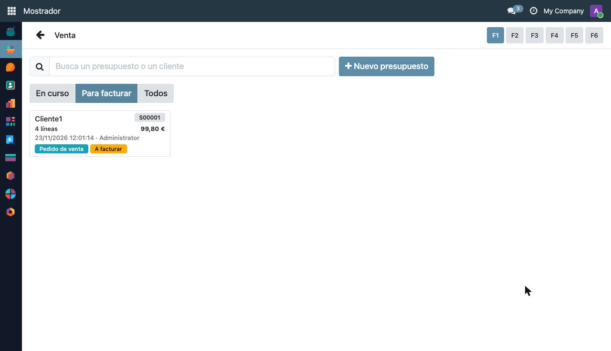
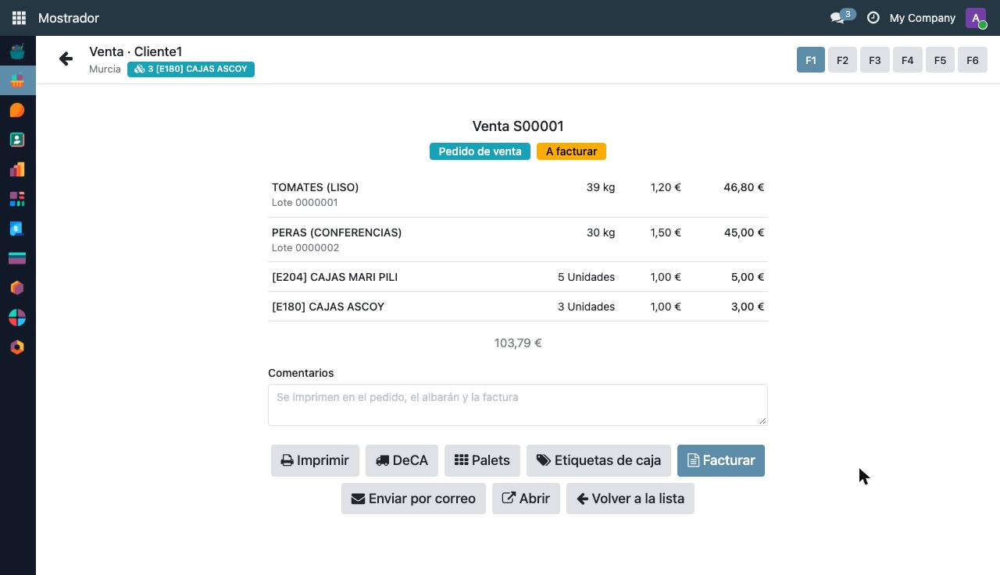
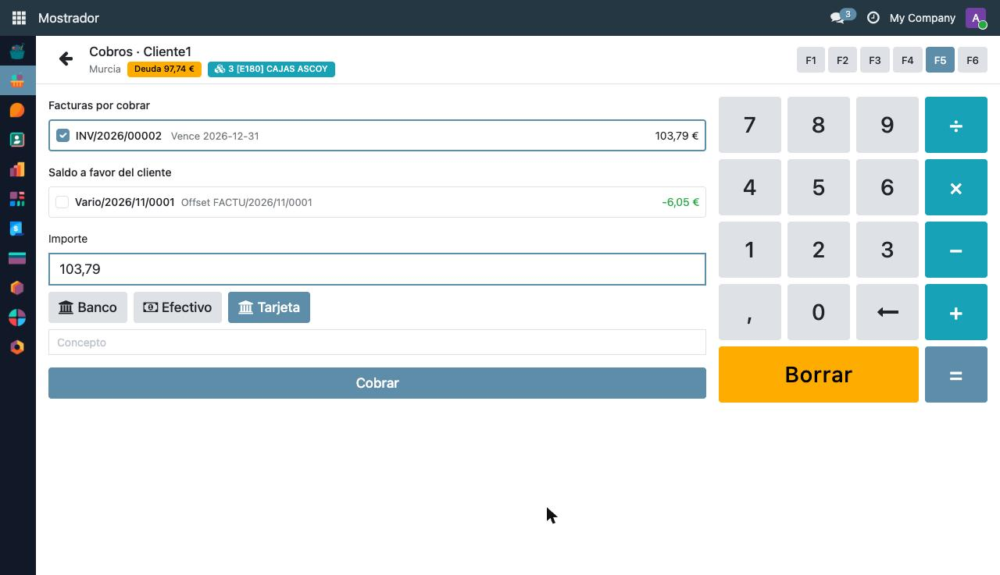
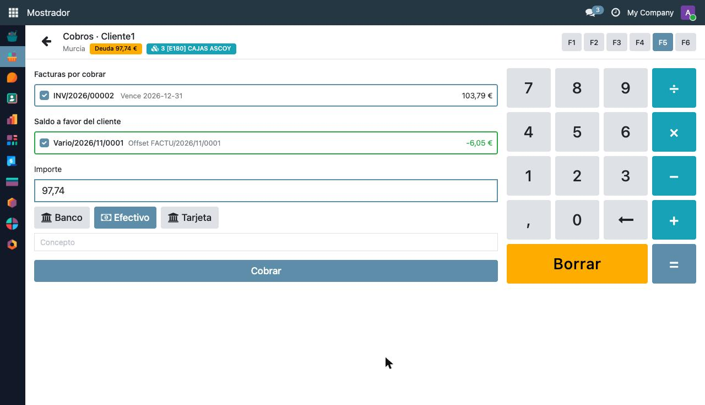
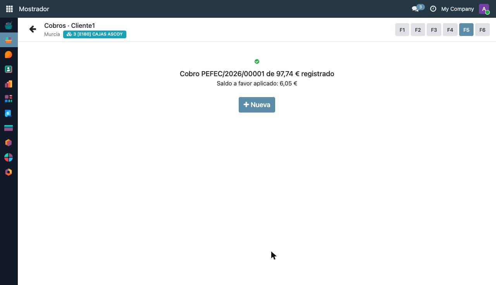

# 12 · Facturación de fin de mes y cobro · Encargado

**Objetivo:** facturar los albaranes de los clientes que pagan a final de mes, ajustar precios especiales y cobrar aplicando su saldo a favor.

**Ejemplo:** Cliente1 se llevó tomate y pera con albarán (venta S00001, [capítulo 20](20_bascula_venta.md)) y después devolvió 5 cajas ([capítulo 22](22_bascula_cajas.md)).

## 1. Pedidos pendientes de facturar

En **F1 · Venta**, toca el filtro **Para facturar** y busca el cliente.

## 2. Revisar el pedido y los precios especiales

Al tocar el pedido se abre su **resumen** con productos, lote, kg, precio e importe, y las cajas:

**Precios especiales:**

- Mientras se vende, el precio de cada línea se cambia en el ticket con el **cambio rápido de precios** ([capítulo 20](20_bascula_venta.md#5-cambio-rápido-de-precios)).
- Si hay que corregirlo después de entregar, pulsa **Abrir** para ir al pedido en Odoo y cambia el precio de la línea **antes de facturar**. Una vez facturado, el cambio se hace con un abono.

## 3. Facturar

Pulsa **Facturar**. La factura se crea, se publica y aparece «Factura INV/2026/00002: 103,79 € por cobrar». La deuda del cliente aparece arriba, en naranja.

> Si el cliente paga más adelante, aquí termina el trabajo. La factura queda pendiente y vence según su plazo de pago.

## 4. Cobrar aplicando el saldo a favor

Pulsa **Cobrar** (o **F5**, y elige el cliente):

- Arriba, **Facturas por cobrar**: las que tienen la casilla marcada son las que se cobran.
- Debajo, **Saldo a favor del cliente**: aquí, los 6,05 € de las cajas que devolvió.

Marca el saldo y el importe baja solo: 103,79 − 6,05 = **97,74 €**. Elige **Efectivo**, **Tarjeta** o **Banco**:

Pulsa **Cobrar**. Se registra el cobro (por ejemplo `PEFEC/2026/00001` de 97,74 €) y se indica «Saldo a favor aplicado: 6,05 €».

### Cobros parciales y anticipos

- **Parcial:** cambia el importe antes de cobrar. La factura queda con el resto pendiente.
- **Sin factura marcada:** el cobro queda como **anticipo** del cliente y saldrá como saldo a favor la próxima vez.
- **Concepto:** texto opcional que acompaña al cobro.
