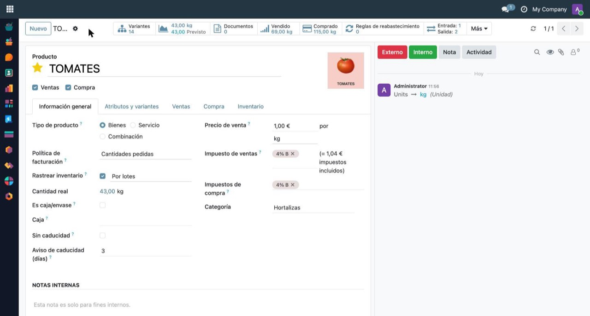
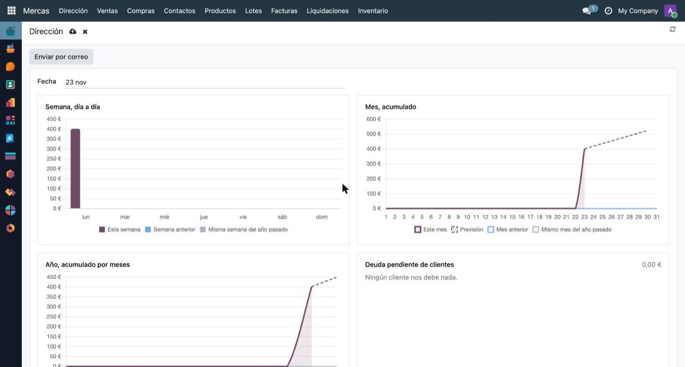
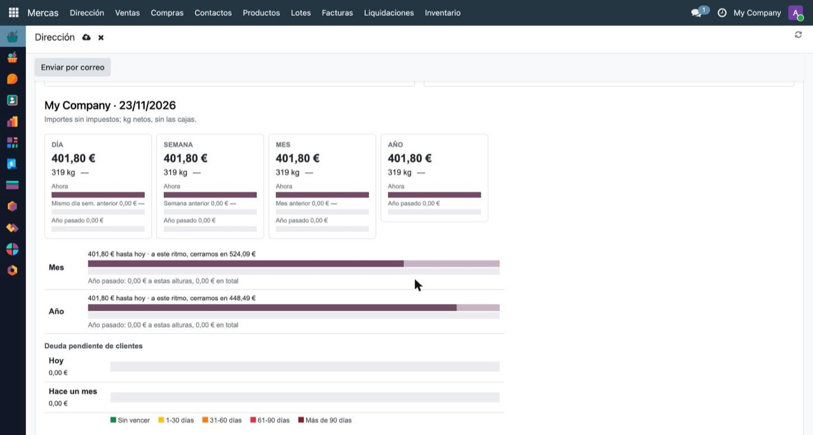

# 13 · Cuadro de mandos: promociones, caducidades y Dirección

El cuadro de mandos tiene dos partes:

- **En el Mostrador**, para la báscula: ventas del día, mensajes, productos en promoción y lotes que caducan ([capítulo 02](02_mostrador.md#el-cuadro-de-mandos-a-la-derecha)). El encargado decide qué sale ahí.
- **En Odoo, menú Mercas › Dirección**, para el encargado y la dirección: cómo van las ventas, las compras, las mermas y la deuda.

## 1. Productos en promoción: la estrella

En la ficha del producto (**Mercas › Productos**), toca la **estrella** junto al nombre.

- El producto sale en **En promoción con stock** del Mostrador mientras tenga stock.
- En la venta (F1), al elegir familia, los productos con estrella **salen los primeros** y con la estrella en la ficha ([capítulo 20](20_bascula_venta.md)).
- Para quitarlo de la promoción, vuelve a tocar la estrella.

## 2. Caducidad de los lotes

En la misma ficha del producto, para los productos con lote:

| Campo | Para qué sirve |
|---|---|
| **Aviso de caducidad (días)** | Cuántos días antes de caducar un lote sale en **Lotes a punto de caducar**. Con **0** solo avisa el mismo día. En la formación, TOMATES, PERAS y PLATANOS tienen **3**. |
| **Sin caducidad** | Sus lotes no caducan. No salen en **Lotes sin fecha de caducidad**. |

La **fecha de caducidad** se pone **en cada lote**: en su ficha (F4 › *Detalle*, o tocando el lote en el cuadro del Mostrador) o en **Mercas › Lotes**.

- Un lote nuevo toma **Sin caducidad** de su producto, pero se puede cambiar lote a lote.
- En la lista de **Mercas › Lotes** hay un filtro **Sin fecha de caducidad** para repasar los que faltan.
- La báscula ve el aviso también **al elegir el lote** en una venta: «Caducado», «Hoy», «Mañana» o «En N días».
- **Un lote caducado se puede vender igualmente**: el Mostrador avisa, pero no lo impide. La decisión es de quien vende.

## 3. Mercas › Dirección

Lo ven los **administradores de ventas** y los **administradores de facturación**. A otra persona se le puede dar el permiso *Mercas: Dirección* (con el modo desarrollador).

Arriba se elige la **fecha** del informe: hoy, por defecto, o cualquier día pasado.

### Gráficos

| Gráfico | Qué compara |
|---|---|
| **Semana, día a día** | Cada día de esta semana con la semana anterior y con la misma semana (por número) del año pasado. |
| **Mes, acumulado** | Lo vendido este mes, día a día y sumando, con el mes anterior y el mismo mes del año pasado. La línea discontinua es la **previsión** de cierre. |
| **Año, acumulado por meses** | Este año con el año pasado, con su previsión. |
| **Deuda pendiente de clientes** | Lo que nos deben, por antigüedad: sin vencer, 1–30, 31–60, 61–90 y más de 90 días. |

Al pasar el dedo (o el ratón) por un punto se ven los importes de ese día o mes.

### Resumen

- **Fichas Día, Semana, Mes y Año:** importe y kg netos, con ▲▼ frente al año pasado. Las barras comparan:
  - **el día** con el mismo día de la semana anterior y con el mismo día de la misma semana del año pasado (lunes de la semana 40 con lunes de la semana 40);
  - **la semana** con la semana anterior completa y con la misma semana completa del año pasado: se ve «llevamos el X %»;
  - **el mes** con el mes anterior completo («llevamos el X %») y con el mismo mes del año pasado.
- **Ritmo del mes y del año:** lo vendido hasta hoy, la previsión de cierre a este ritmo y lo del año pasado a estas alturas y en total.
- **Deuda de clientes:** la de hoy y la de hace un mes, a la misma escala, para ver si la deuda vieja crece.
- Más abajo, las tablas: **ventas** (importe, kg, precio/kg, ventas y cajas), **compras y mermas** (% de merma), **deuda** (clientes y proveedores, por antigüedad y los que más deben), **pendiente** (ventas sin facturar y lotes por liquidar) y **cobros del día** por diario.

Todos los importes son **sin impuestos**, y los kg son **netos**, sin las cajas.

### El informe por correo

El botón **Enviar por correo** lo manda en el momento. Además, cada tarde sale solo a quien lo tenga activado en su usuario:

**Ajustes › Usuarios** › el usuario › pestaña **Permisos de acceso** › sección **Ventas** › **Resumen de Dirección por correo**: **Cada tarde**.

- El usuario necesita un **correo electrónico** en su ficha.
- Quien lo recibe por correo también puede ver la pantalla de Dirección.
- El correo lleva las fichas, el ritmo, la deuda y las tablas, pero **no los gráficos de arriba**: los programas de correo no los muestran.
