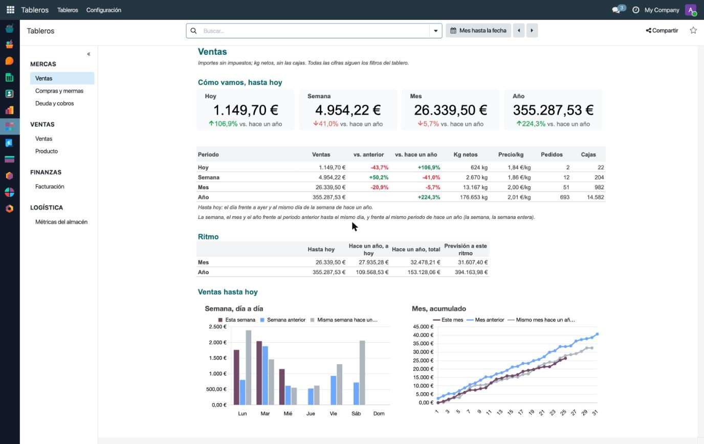
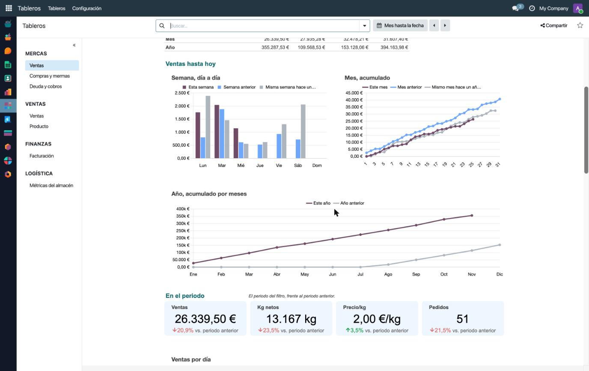
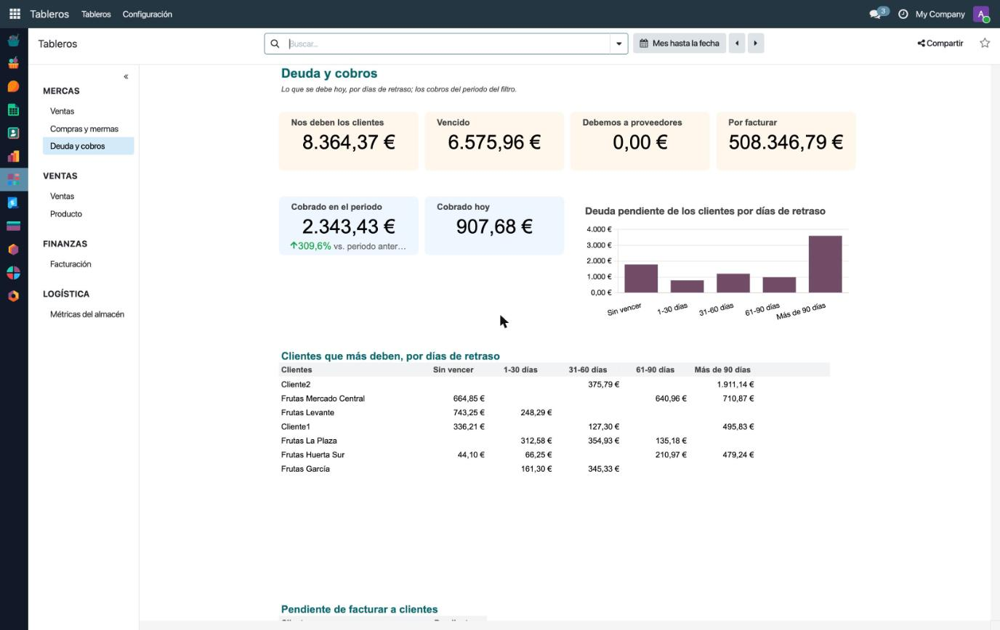
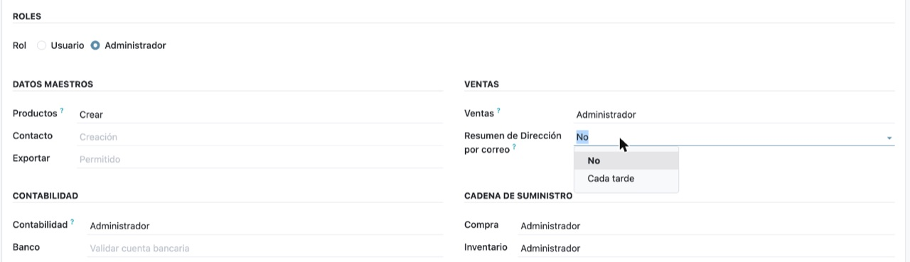

# 13 · Cuadro de mandos: promociones, caducidades y Dirección

El cuadro de mandos tiene dos partes:

- **En el Mostrador**, para la báscula: ventas del día, mensajes, productos en promoción y lotes que caducan ([capítulo 02](02_mostrador.md#el-cuadro-de-mandos-a-la-derecha)). El encargado decide qué sale ahí.
- **En Odoo, Tableros › Tableros › Mercas**, para el encargado y la dirección: cómo van las ventas, las compras, las mermas y la deuda.

## 1. Productos en promoción: la estrella

En la ficha del producto (**Mercas › Productos**), toca la **estrella** junto al nombre.

- El producto sale en **En promoción con stock** del Mostrador mientras tenga stock.
- En la venta (F1), al elegir familia, los productos con estrella **salen los primeros** y con la estrella en la ficha ([capítulo 20](20_bascula_venta.md)).
- Para quitarlo de la promoción, vuelve a tocar la estrella.

## 2. Caducidad de los lotes

En la misma ficha del producto, para los productos con lote:

| Campo | Para qué sirve |
|---|---|
| **Aviso de caducidad (días)** | Cuántos días antes de caducar un lote sale en **Lotes a punto de caducar**. Con **0** solo avisa el mismo día. En la formación, TOMATES, PERAS y PLATANOS tienen **3**. |
| **Sin caducidad** | Sus lotes no caducan. No salen en **Lotes sin fecha de caducidad**. |

La **fecha de caducidad** se pone **en cada lote**: en su ficha (F4 › *Detalle*, o tocando el lote en el cuadro del Mostrador) o en **Mercas › Lotes**.

- Un lote nuevo toma **Sin caducidad** de su producto, pero se puede cambiar lote a lote.
- En la lista de **Mercas › Lotes** hay un filtro **Sin fecha de caducidad** para repasar los que faltan.
- La báscula ve el aviso también **al elegir el lote** en una venta: «Caducado», «Hoy», «Mañana» o «En N días».
- **Un lote caducado se puede vender igualmente**: el Mostrador avisa, pero no lo impide. La decisión es de quien vende.

## 3. Tableros › Tableros › Mercas

Lo ven los **administradores de ventas** y los **administradores de facturación**. A otra persona se le puede dar el permiso *Mercas: Dirección* (con el modo desarrollador).

En la aplicación **Tableros**, a la izquierda, el grupo **Mercas** tiene tres tableros: **Ventas**, **Compras y mermas** y **Deuda y cobros**. Arriba están los **filtros**: el **periodo** (por defecto, el mes hasta hoy; las flechas pasan al periodo anterior o al siguiente) y, en el buscador, el cliente o proveedor, el producto, la categoría y el comercial. Todas las cifras siguen los filtros.

Todos los importes son **sin impuestos**, y los kg son **netos**, sin las cajas.

**Solo cuenta la mercancía de las familias marcadas como *Mercancía de mercado*.** Las **cajas** van aparte (cuántas y por cuánto se venden o entregan, y se compran o devuelven), y los productos de otras familias (material, servicios…) no entran. La deuda y los cobros sí son de todas las facturas. Cada tablero, y el resumen por correo, lo recuerdan en su cabecera.

### Ventas: cómo vamos, hasta hoy

- **Fichas Hoy, Semana, Mes y Año:** lo vendido, con ▲▼ frente al mismo periodo de hace un año.
- **La tabla** añade la variación frente al periodo anterior, los kg netos, el precio/kg, los pedidos y las cajas:
  - **el día** se compara con ayer y con el mismo día de la semana de hace un año (52 semanas antes);
  - **la semana, el mes y el año**, con el periodo anterior hasta el mismo día y con el mismo periodo de hace un año (la semana, con la semana entera).
- **Ritmo del mes y del año:** lo vendido hasta hoy, lo de hace un año a estas alturas y en total, y la **previsión** de cierre a este ritmo.

Esta parte no depende del filtro de periodo: siempre es hasta hoy.

### Ventas: gráficos y el periodo

| Gráfico | Qué compara |
|---|---|
| **Semana, día a día** | Cada día de esta semana con la semana anterior y con la misma semana del año pasado. |
| **Mes, acumulado** | Lo vendido este mes, día a día y sumando, con el mes anterior y el mismo mes del año pasado. |
| **Año, acumulado por meses** | Este año con el año pasado. |

Debajo, **En el periodo**: las ventas, los kg, el precio/kg y los pedidos del periodo del filtro frente al periodo anterior, las ventas por día y los **mejores clientes, productos y categorías**. Al tocar un gráfico o una cifra se abre el detalle en Odoo.

### Compras y mermas

Lo mismo para las compras, con los **kg de merma** y el **% de merma** (kg desechados sobre los kg comprados) de cada periodo, los proveedores, los productos comprados, las mermas por producto y los **lotes por liquidar** (vendidos del todo, en liquidación por venta, aún sin liquidar al proveedor).

### Deuda y cobros

- **Fichas:** lo que nos deben los clientes y cuánto está **vencido**, lo que debemos a proveedores y lo **pendiente de facturar**; lo **cobrado en el periodo** (frente al anterior) y **hoy**.
- **Deuda por días de retraso:** sin vencer, 1–30, 31–60, 61–90 y más de 90 días, en un gráfico y por cliente (los que más deben primero).
- Lo pendiente de facturar por cliente, lo que debemos a cada proveedor y los **cobros** del periodo por día y por diario.

### El informe por correo

Cada tarde sale solo a quien lo tenga activado en su usuario; para mandarlo en el momento, **Ajustes › Compañías** › la compañía › pestaña **Mercas** › **Enviar el resumen ahora**:

**Ajustes › Usuarios** › el usuario › pestaña **Permisos de acceso** › sección **Ventas** › **Resumen de Dirección por correo**: **Cada tarde**.

- El usuario necesita un **correo electrónico** en su ficha.
- Quien lo recibe por correo también puede ver los tableros de Mercas.
- El correo lleva las mismas cifras que los tableros (fichas, ritmo, deuda y tablas), pero **no sus gráficos**: los programas de correo no los muestran.
