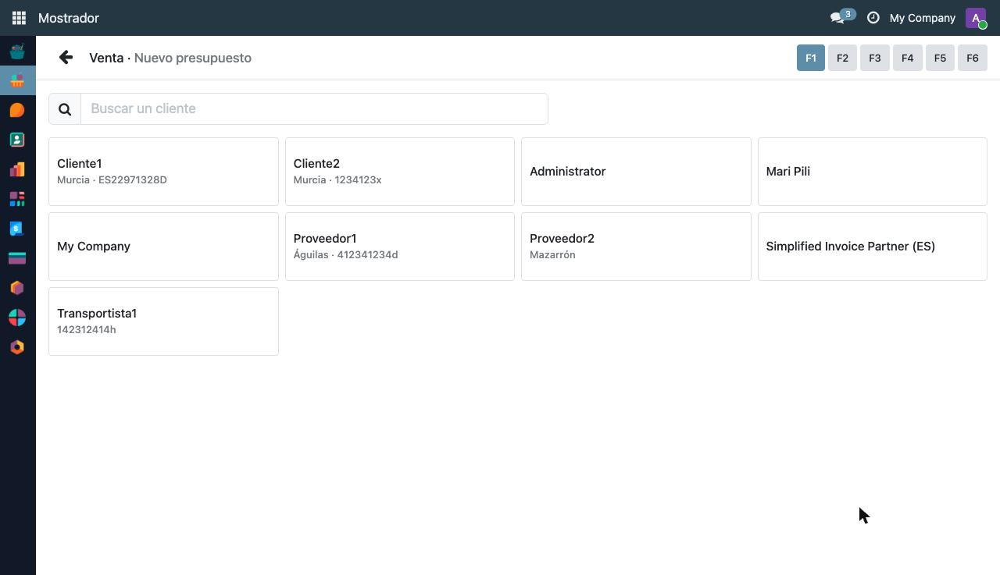
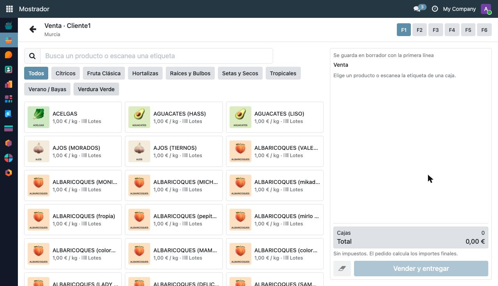
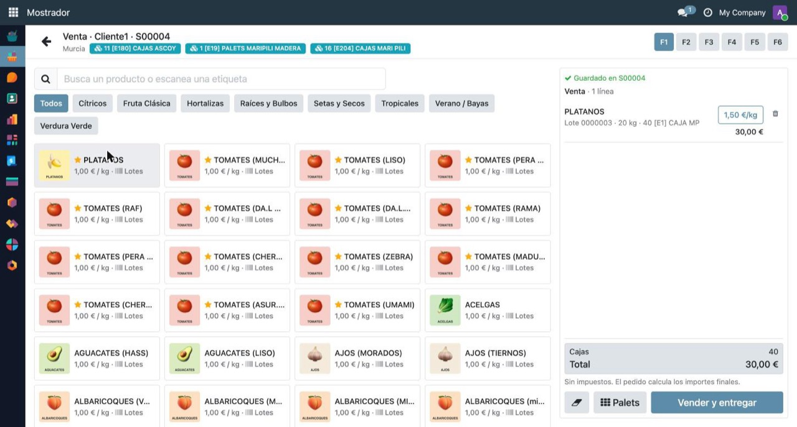
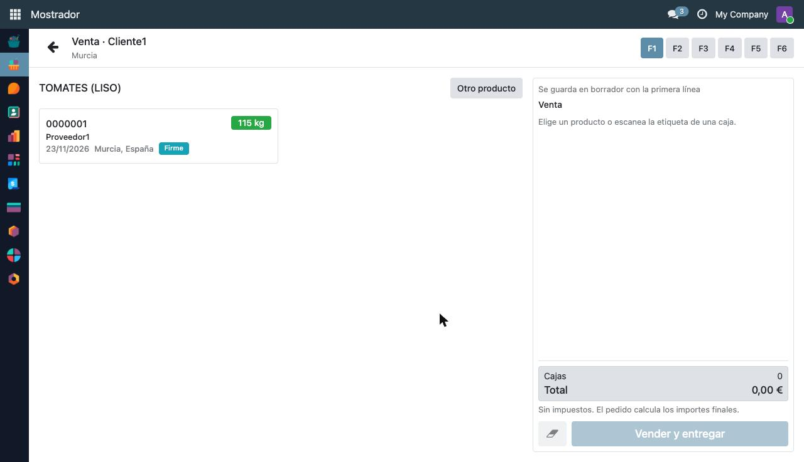
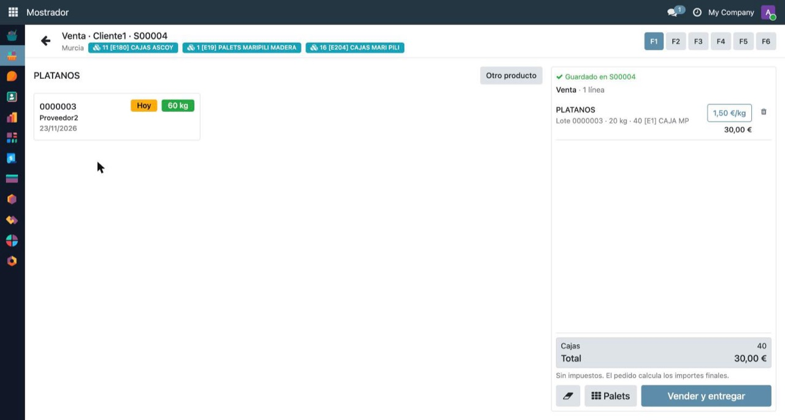
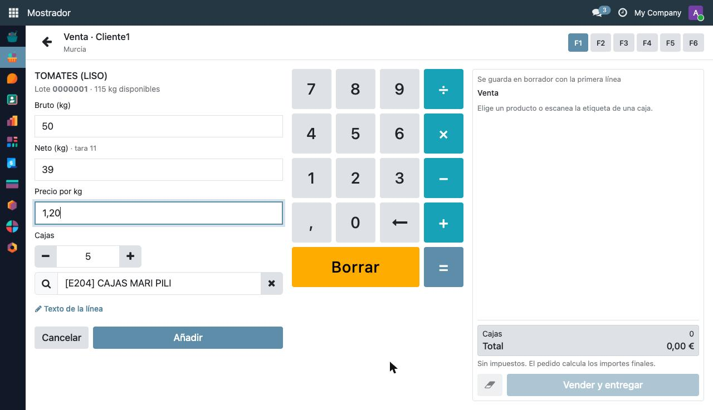
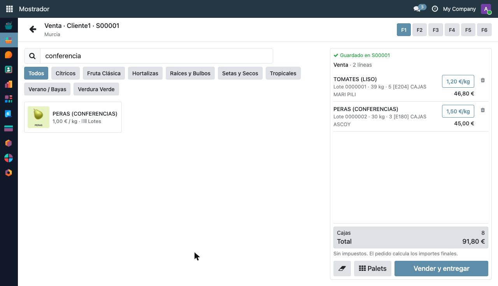
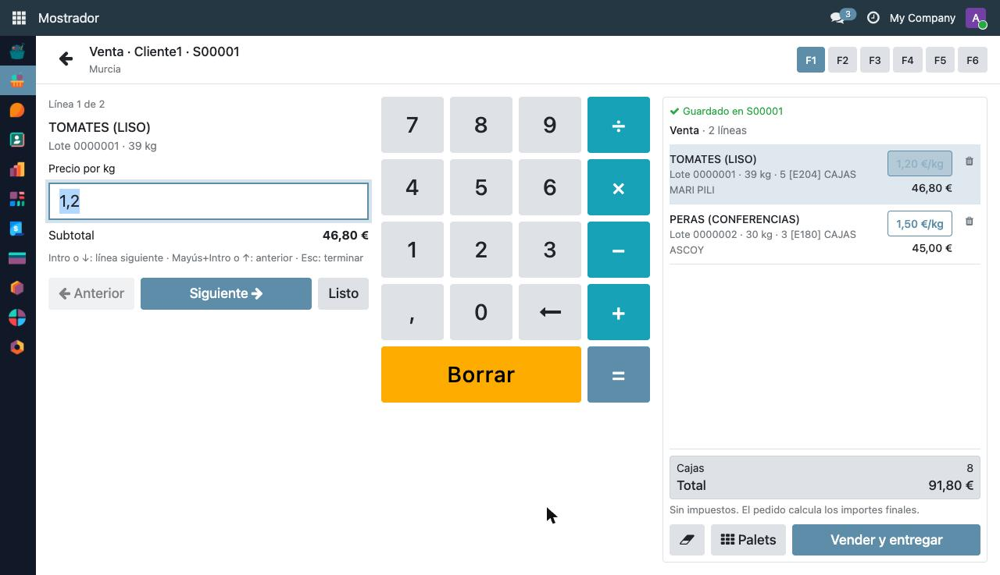
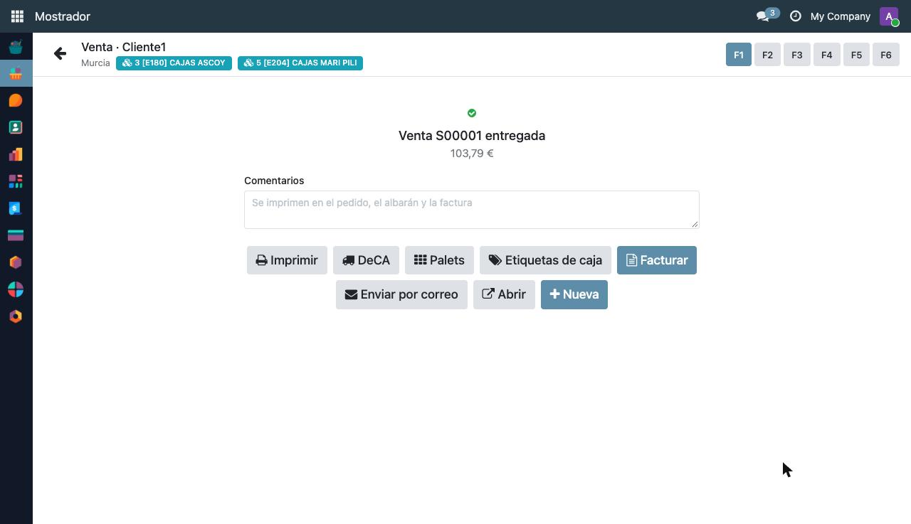
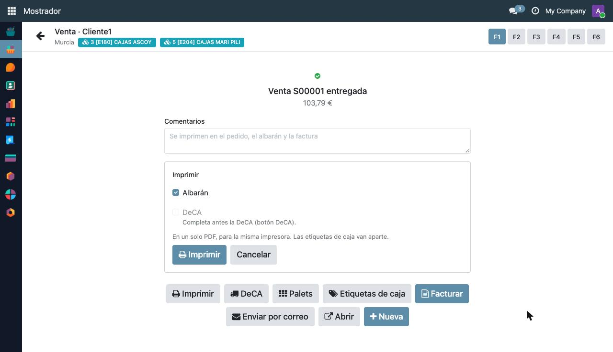

# 20 · Vender y entregar (F1) · Báscula

**Objetivo:** despachar a un cliente o preparar un pedido: pesar, poner cajas y precio, y entregar con el albarán.

**Ejemplo:** Cliente1 (paga a fin de mes) se lleva tomate en **nuestras cajas** y pera en las **mismas cajas de la compra**.

## 1. Nuevo presupuesto y cliente

Pulsa **F1**, luego **+ Nuevo presupuesto**, y busca el cliente por nombre, NIF o teléfono.

> Para clientes ocasionales existe la ficha **CLIENTES CONTADO**.

Arriba, junto al nombre, se ven en cuanto existen:

- la **deuda** del cliente, en naranja (en rojo si está vencida);
- las **cajas nuestras** que tiene, en azul;
- un aviso si supera su **riesgo** o crédito.

## 2. Producto o etiqueta

Toca el producto, búscalo, o **escanea la etiqueta de una caja**: se abre directamente su lote.

Los productos **en promoción** llevan una ⭐ y salen **los primeros** en cada familia: son los que el encargado quiere que se ofrezcan antes ([capítulo 13](13_encargado_cuadro_de_mandos.md)).

## 3. Lote

Se ven los lotes con stock, **el más antiguo primero**: kg disponibles, proveedor, fecha, origen y si es **Firme**. Elige el que vas a despachar (normalmente el primero).

Si un lote **caduca pronto o ya ha caducado**, lleva una etiqueta de color: **Caducado** (rojo), **Hoy**, **Mañana** o **En N días**. Se puede vender igualmente, pero fíjate antes de elegirlo y, si tienes dudas, pregunta al encargado.

## 4. La línea: bruto, cajas y precio

1. **Cajas y tipo de caja.** Cuenta las cajas y elige su tipo:
   - **Cajas propias** (tomate en el ejemplo): `[E204] CAJAS MARI PILI`.
   - **Las mismas cajas de la compra** (pera): el tipo del proveedor, `[E180] CAJAS ASCOY`.
2. **Bruto:** lo que marca la báscula. El cursor empieza en este campo.
3. Comprueba el **Neto**: 50 − 5 × 2,2 = **39 kg** (al lado se ve «tara 11»).
4. **Precio por kg.**
5. Opcional: **Texto de la línea**, que se imprime bajo el producto.

Pulsa **Añadir**.

> No deja vender más de lo que queda en el lote, contando lo que ya está en el ticket.

## 5. Cambio rápido de precios

En el ticket, **el precio de cada línea es un botón**. Al tocarlo se abre el editor de precios:

- La primera tecla **sustituye** el precio, como en una caja registradora, y el subtotal se ve al momento.
- **Siguiente / Anterior** (o **Intro / ↓** y **Mayús+Intro / ↑**) pasan de una línea a otra. **Listo** o **Esc** terminan.

Tocando el **nombre** de una línea se modifica entera (kg, cajas…). La **papelera** quita la línea. El botón de la **goma** (abajo a la izquierda) cancela el presupuesto, y pide confirmación antes.

## 6. Vender y entregar

Pulsa **Vender y entregar**. El pedido se confirma y el albarán queda validado en un solo paso:

- El total (103,79 €) incluye el IVA y **las cajas**, que se cobran como envase. Arriba se ven las cajas que ahora tiene el cliente.
- **Comentarios:** texto que se imprime en el pedido, el albarán y la factura.

## 7. Imprimir el albarán

**Imprimir** muestra los documentos disponibles, que salen juntos en un solo PDF:

- **Albarán:** siempre.
- **DeCA:** solo si está completa. Antes hay que rellenarla con el botón **DeCA** (transportista, matrículas…).
- **Packing list:** si hay palets.
- **Factura:** si ya existe.

**Etiquetas de caja** va aparte, a la impresora de etiquetas.

> **Cliente de fin de mes (Cliente1):** aquí termina. Se lleva el albarán y el encargado le facturará a fin de mes ([capítulo 12](12_encargado_facturacion.md)).
> **Cliente de contado:** sigue en el [capítulo 21](21_bascula_contado.md).

## Pedidos con palets, transporte o envío por correo

Los **palets** y el **packing list**, la **DeCA** (documento de control del transporte) y el **envío por correo** de los documentos se explican en el [capítulo 24](24_bascula_palets_deca_correo.md).
