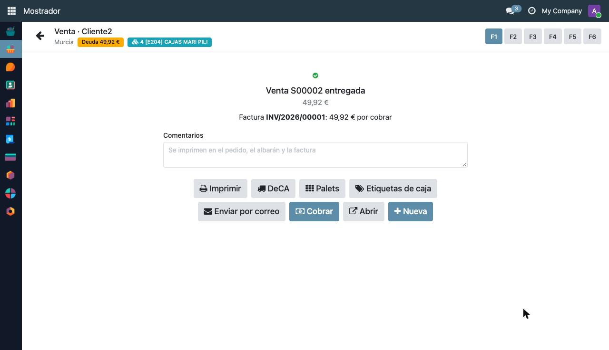
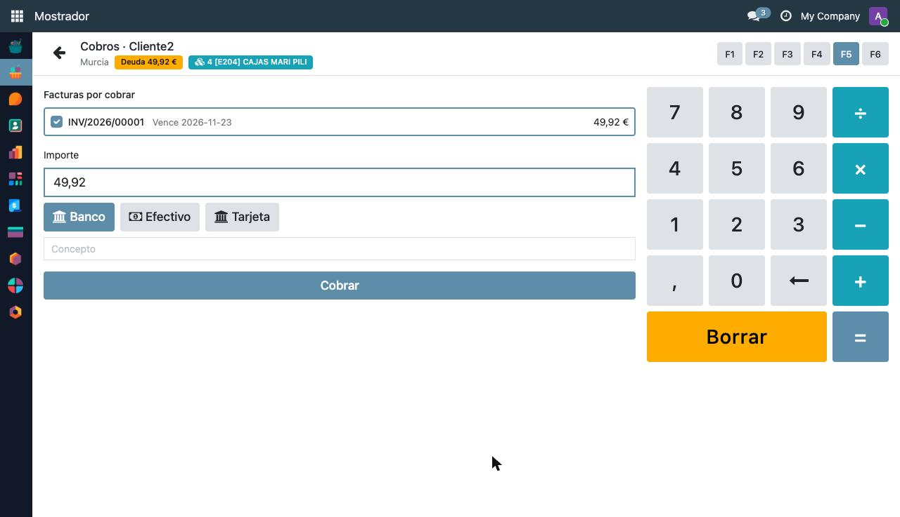
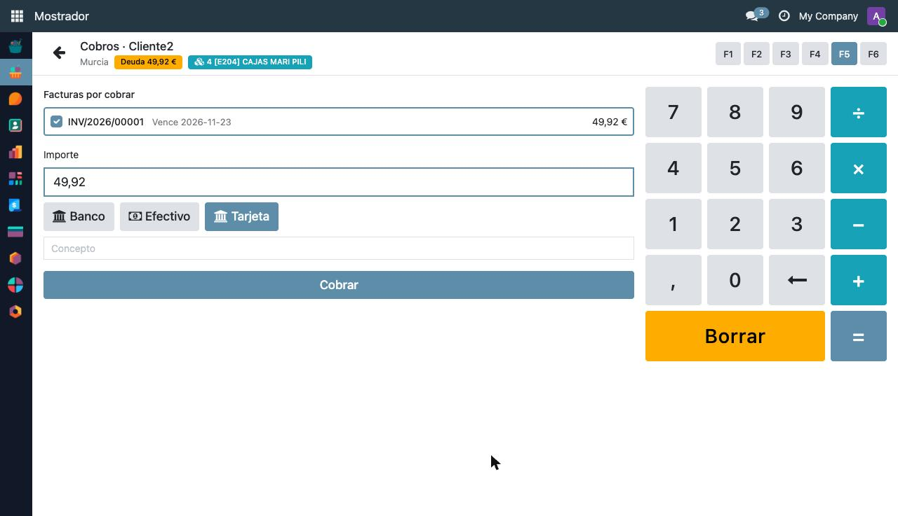
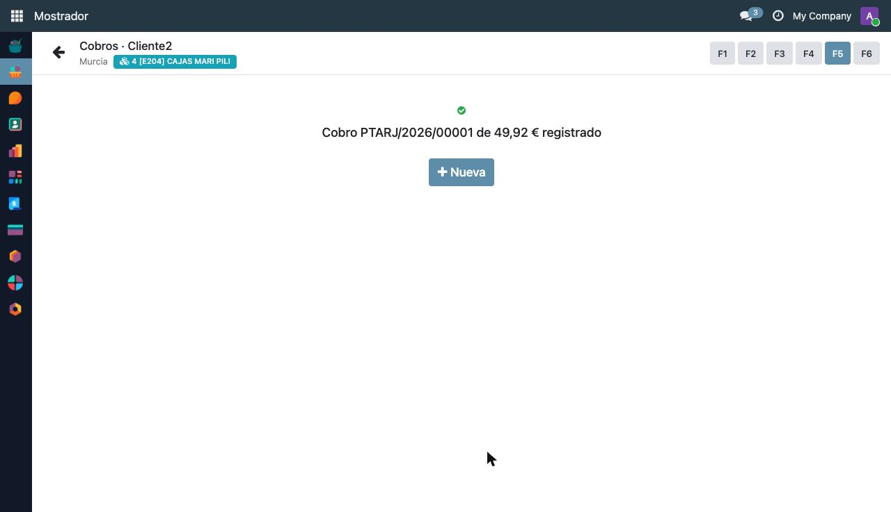

# 21 · Venta de contado: facturar y cobrar · Báscula

**Objetivo:** al cliente que paga en el momento, hacerle la factura y cobrarle con tarjeta o en efectivo.

**Ejemplo:** Cliente2 se lleva 4 cajas de plátano: 48,8 kg brutos, 40 kg netos a 1,10 €/kg.

## 1. Vender y entregar

Igual que en el [capítulo 20](20_bascula_venta.md).

## 2. Facturar

En la pantalla final pulsa **Facturar**:

La factura se crea y se publica al momento: «Factura INV/2026/00001: 49,92 € por cobrar». Arriba aparece la deuda del cliente.

## 3. Cobrar

Pulsa **Cobrar**. Se abre *Cobros* (F5) con la factura ya marcada y su importe:

Elige cómo paga:

| Botón | Cuándo |
|---|---|
| **Efectivo** | Paga en billetes o monedas. |
| **Tarjeta** | Paga con el datáfono. |
| **Banco** | Transferencia. |

Pulsa **Cobrar**:

La deuda desaparece de la cabecera y solo quedan las cajas que tiene el cliente.

> **Cuidado:** el Mostrador recuerda el último medio de pago usado. Comprueba siempre que está marcado el correcto antes de pulsar *Cobrar*.

## 4. Imprimir

Si el cliente quiere el papel, vuelve a la venta (F1 › *Todos*) y pulsa **Imprimir**: ahora la lista incluye la **factura** además del albarán.
