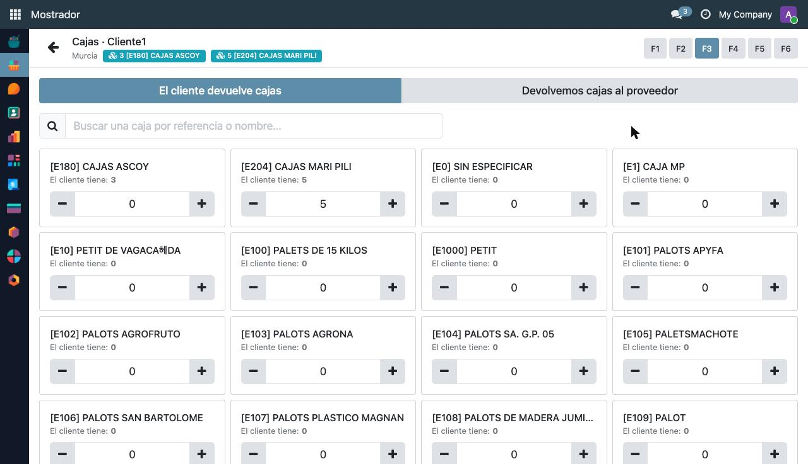
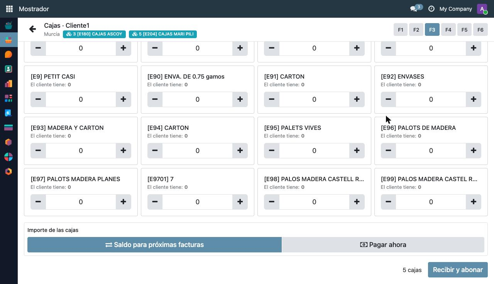
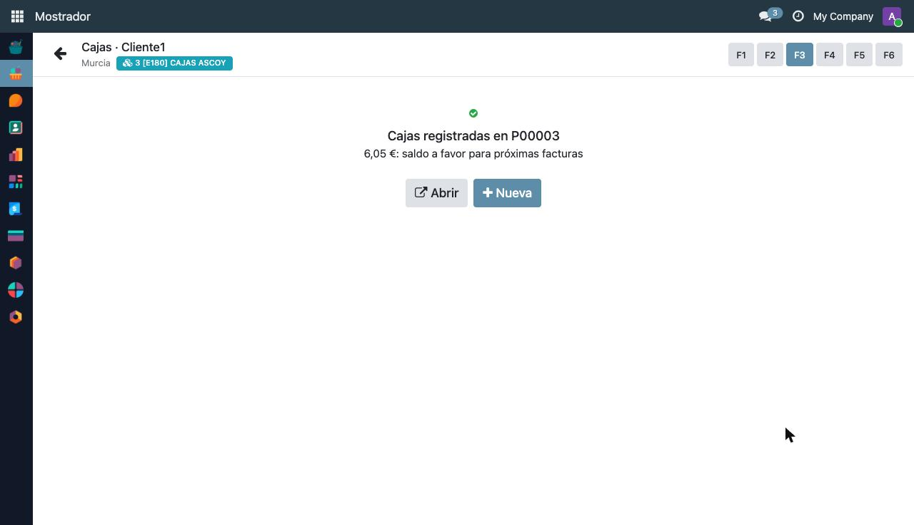

# 22 · El cliente devuelve cajas (F3) · Báscula

**Objetivo:** registrar las cajas que nos devuelve un cliente y decidir qué se hace con su importe.

**Ejemplo:** Cliente1 devuelve las 5 CAJAS MARI PILI de su compra.

## 1. Elegir el cliente

Pulsa **F3** y busca el cliente. Arriba se ven las cajas nuestras que tiene.

## 2. Contar las cajas

Con **El cliente devuelve cajas** seleccionado, cada tipo de caja muestra «El cliente tiene: N». Ajusta con **+ / −** o escribe el número:

> Las cajas que tiene el cliente salen **las primeras**. Usa el buscador si el tipo de caja no está a la vista.

## 3. ¿Qué hacemos con el importe?

Baja hasta el final de la pantalla:

| Opción | Qué pasa |
|---|---|
| **Saldo para próximas facturas** | El importe queda **a favor del cliente** y se descuenta al cobrarle la próxima factura (F5). Es lo normal con clientes de fin de mes. |
| **Pagar ahora** | Se le devuelve el dinero en el momento. Hay que elegir *Efectivo* o *Banco*. |

El botón **Recibir y abonar** no se activa hasta que se elige una de las dos opciones.

## 4. Recibir y abonar

«6,05 €: saldo a favor para próximas facturas». En la cabecera ya no aparecen esas cajas.

## Devolvemos cajas al proveedor

La pestaña **Devolvemos cajas al proveedor** funciona igual, en sentido contrario: se elige el proveedor, se indican las cajas que le entregamos y se factura.
