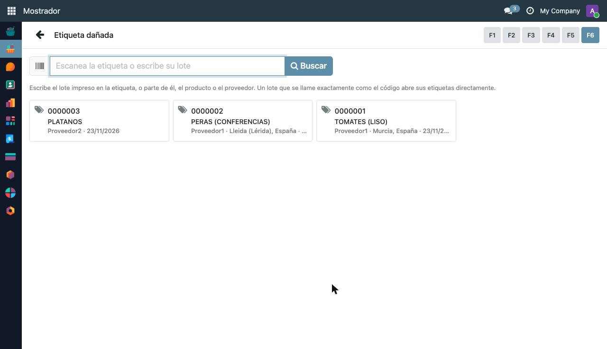
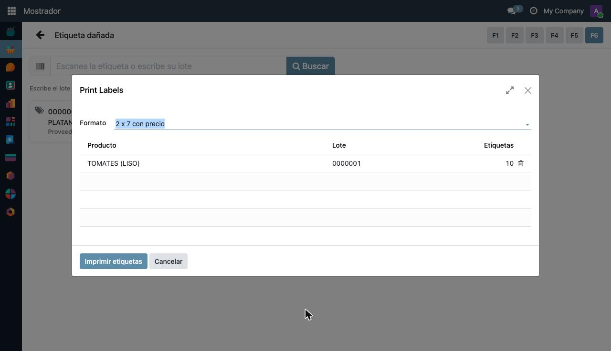

# 23 · Etiqueta dañada (F6) · Báscula

**Objetivo:** reponer la etiqueta de una caja que se ha roto o mojado.

## 1. Buscar el lote

Pulsa **F6**. El campo de búsqueda ya está listo:

- **Escanea** la etiqueta, si todavía se puede leer: se abren directamente sus etiquetas.
- O **escribe** el lote (o parte de él), el producto o el proveedor, y pulsa **Intro** o **Buscar**.

Sin escribir nada se ven los últimos lotes recibidos:

## 2. Imprimir solo las que hacen falta

El asistente propone **una etiqueta por cada caja comprada** (10 en el ejemplo). Si solo se ha estropeado una, **cámbialo a 1** antes de pulsar *Imprimir etiquetas*.

> Aquí salen todos los lotes, también los ya facturados al proveedor.
