# 24 · Palets, DeCA y envío por correo · Báscula

**Objetivo:** preparar un pedido grande en palets, completar el documento de transporte (DeCA) y mandar los documentos al cliente.

**Ejemplo:** Cliente1 se lleva 24 cajas (tomate, pera y plátano) en un camión de Transportista1.

## 1. Palets

En el ticket de la venta, cuando hay líneas con cajas, aparece el botón **Palets**:

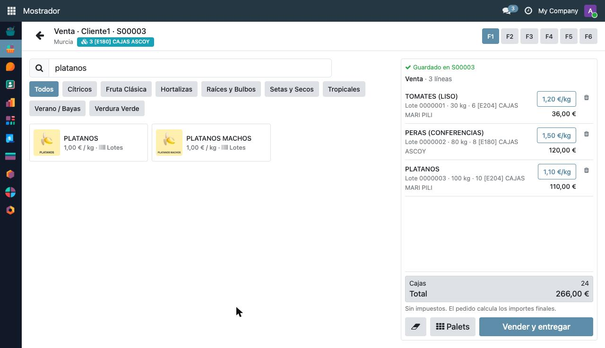

Al tocarlo se guarda el presupuesto y se abre el reparto. Al principio todas las cajas están en **Sin palet**:

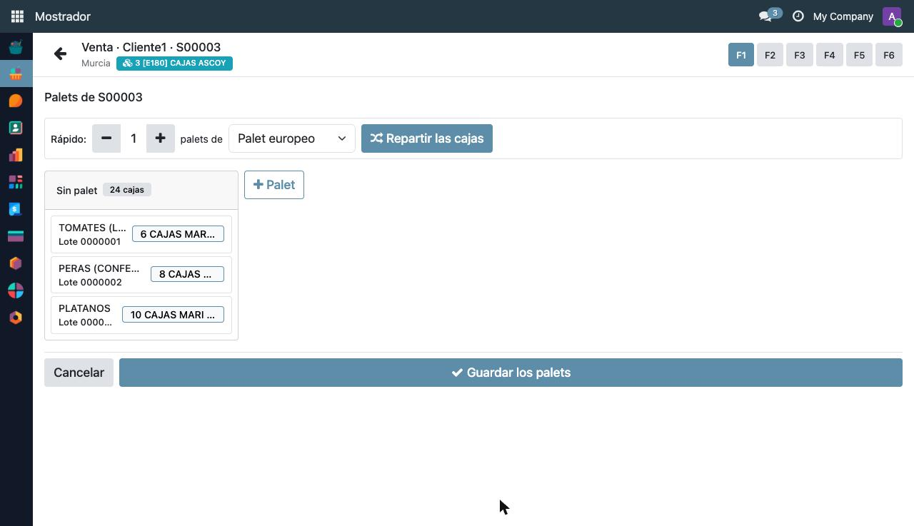

### Reparto rápido

Elige cuántos palets y de qué tipo, y pulsa **Repartir las cajas**. Cada línea va entera al palet con menos cajas, empezando por la mayor:

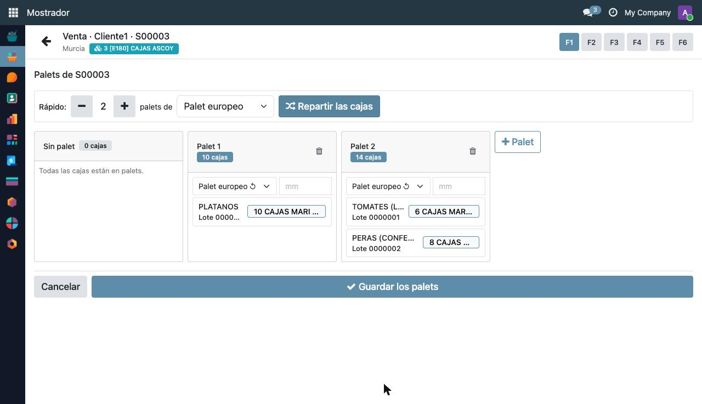

### Ajuste a mano (gráfico)

Para mover cajas de un palet a otro:

1. Toca la ficha de la línea (aquí, la pera del palet 2).
2. Indica **cuántas cajas** mover con el teclado o con − / + (por defecto, todas).
3. Toca **Poner N aquí** en el palet de destino, o **Quitarlas del palet** en *Sin palet*.

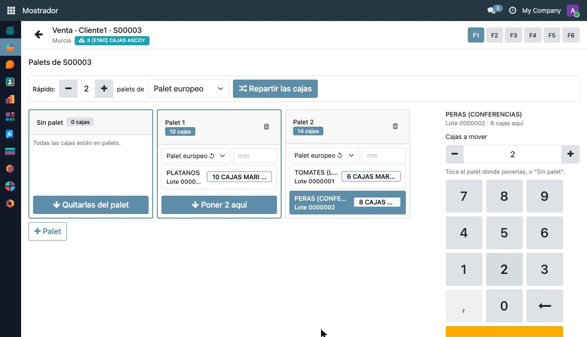

Cada palet tiene su **tipo** y su **altura** en mm (opcional: si se deja vacía, se usa la del tipo). El símbolo **↺** marca los palets **retornables** (europalet): se le apuntan al cliente como un envase más.

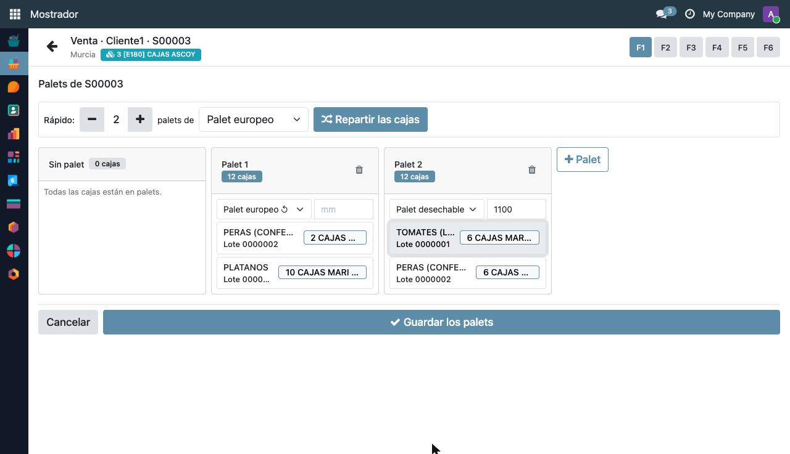

Pulsa **Guardar los palets**. Con **Cancelar** o la flecha atrás se descartan los cambios (pide confirmación).

> Se toca y se suelta: no hace falta arrastrar, para que funcione bien en la tableta.

Después, **Vender y entregar** como siempre. Cada palet pasa a ser un bulto del albarán, con su número (`PAL0000001`, `PALD0000001`…). El europalet aparece en la cabecera junto a las cajas que tiene el cliente:

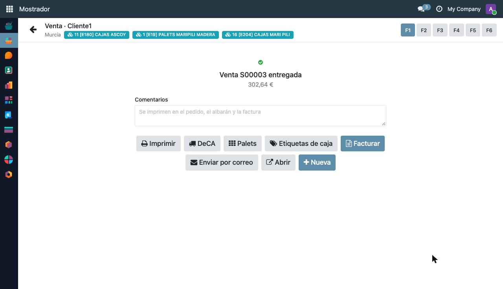

> Si hay que corregir el reparto después de entregar, el botón **Palets** sigue disponible. Si cambia el número de europalets, el Mostrador avisa para registrarlo en **Cajas (F3)**.

## 2. DeCA (documento de control del transporte)

Pulsa **DeCA**. Se abre el diálogo del albarán, que avisa arriba de los datos que faltan:

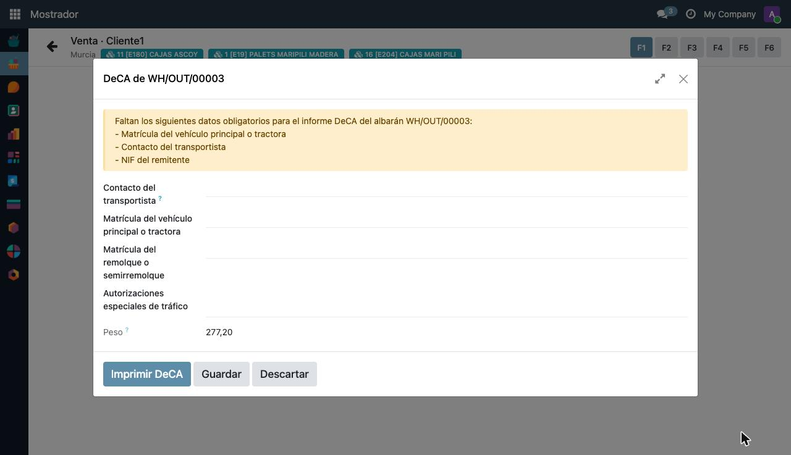

Rellena:

- **Contacto del transportista** (con su NIF). El Mostrador lo propone según el ajuste de la empresa: el del último albarán del cliente, el propio cliente o ninguno.
- **Matrícula** de la tractora y del remolque.
- **Autorizaciones especiales**, si las hay.
- El **peso** se calcula solo.

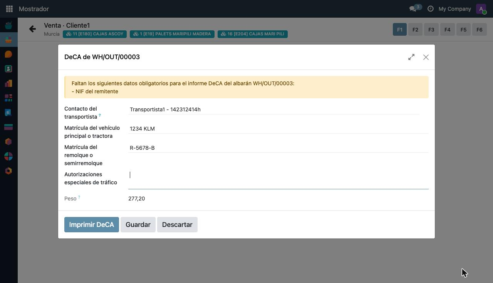

Si el aviso nombra el **NIF del remitente** o el **NIF del cliente**, el dato falta en la ficha de la empresa o del cliente: avisa al encargado.

Con todo completo desaparece el aviso:

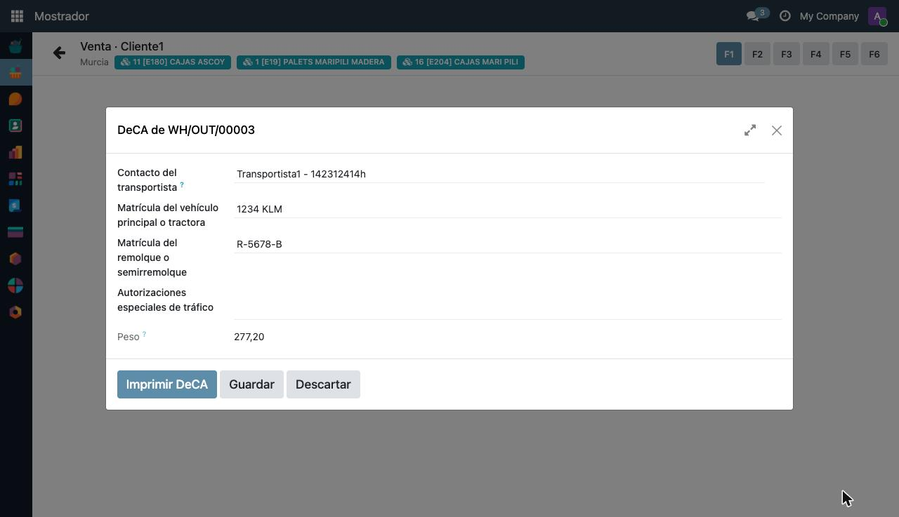

- **Guardar** guarda los datos sin imprimir.
- **Imprimir DeCA** guarda los datos e imprime el documento.

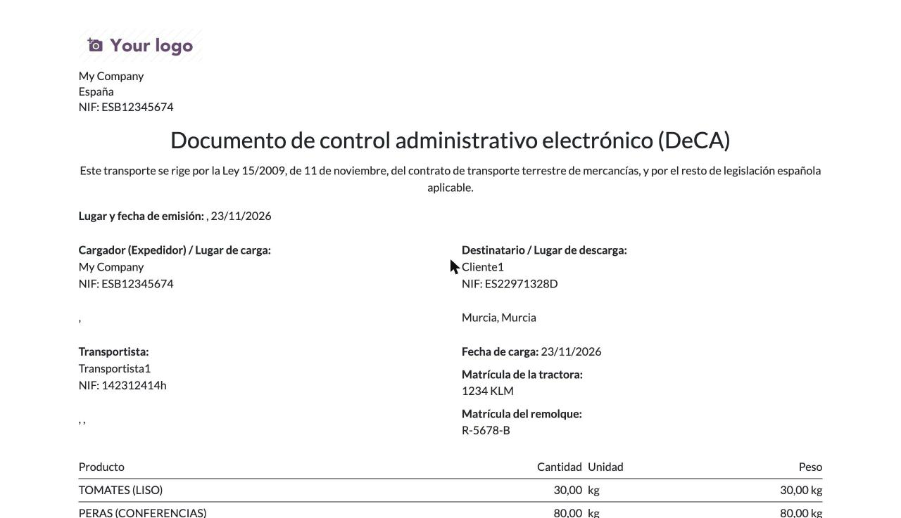

> Si se cambian los datos después de imprimir, se genera una versión nueva de la DeCA.

## 3. Imprimir todo junto

Con la DeCA completa y los palets hechos, **Imprimir** ofrece **albarán**, **DeCA** y **packing list** (y la **factura**, si existe). Salen en un único PDF:

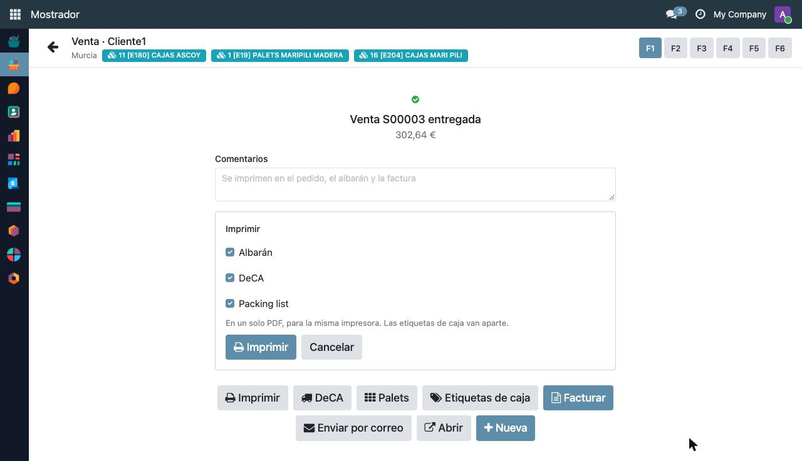

El **packing list** detalla cada palet (número, tipo, medidas y volumen), las cajas de cada línea con su lote y origen, y el neto, la tara y el bruto:

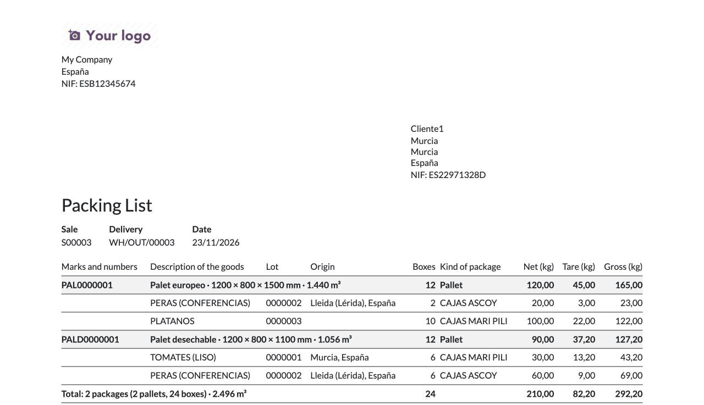

## 4. Enviar por correo

**Enviar por correo** muestra los documentos disponibles y la dirección a la que irá cada uno:

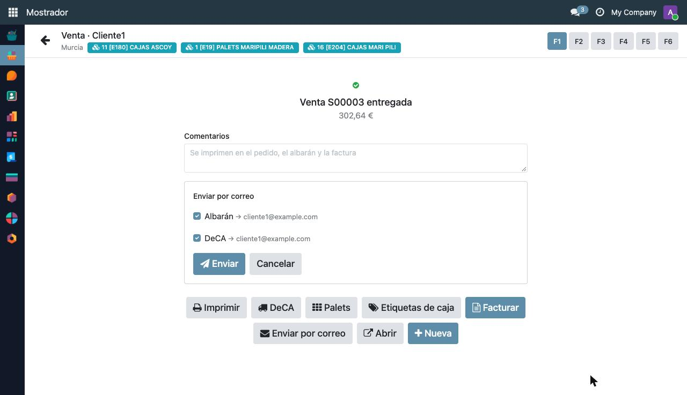

- **Albarán** y **DeCA** van al contacto de entrega del pedido.
- La **factura**, cuando existe, va al contacto de facturación.
- Si los dos contactos tienen el mismo correo, todo va en un único mensaje.
- Si a algún contacto le falta el correo, no se envía nada y aparece un aviso.

Pulsa **Enviar**. El correo sale por el servidor de correo de Odoo. Si no hay ninguno configurado, se queda en la cola.

> El envío desde el Mostrador no muestra una vista previa. Revisa bien los destinatarios antes de pulsar **Enviar**.
